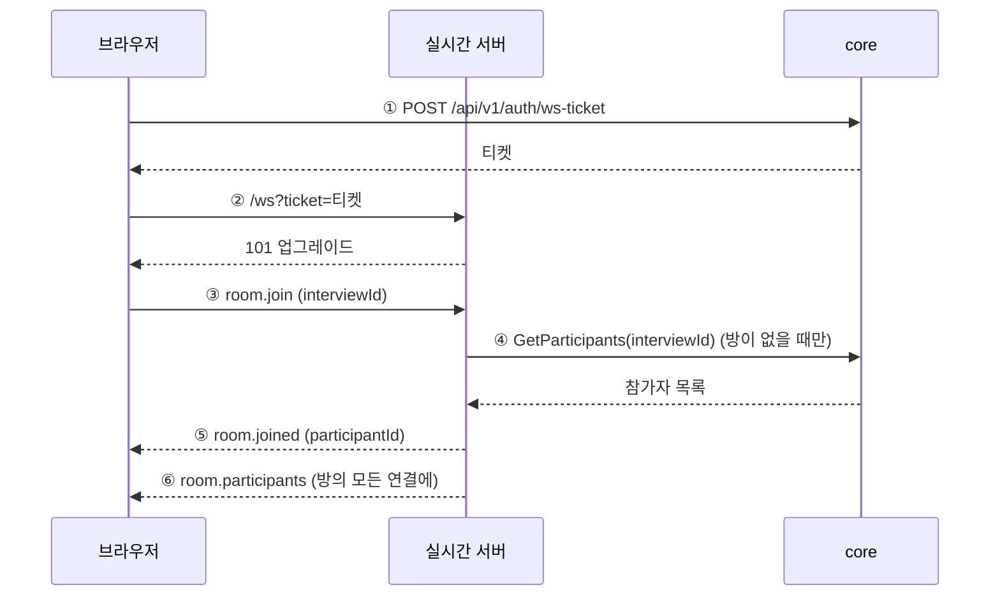
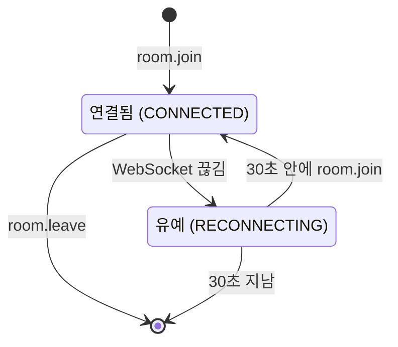

# 면접방 설계

담당: happyhun | 최종 갱신: 2026-11-27

## 개요

실시간 서버가 브라우저의 WebSocket 연결을 받아 면접방에 들이고, 방마다 누가 들어와 있는지 관리한다. 음성 같은 방 안 기능은 이 연결과 참가자 정보를 그대로 쓴다. core는 접속 티켓과 참가자 목록만 준다.

## 목표와 비목표

**목표**

- 예약된 참가자만 방에 들어온다. 접속 인증은 [인증/인가 설계](auth.md)의 티켓으로, 참가 여부는 core의 참가자 목록으로 확인한다.
- 참가자는 방에 누가 있는지(닉네임, 역할)와 각자 지금 연결돼 있는지를 안다.
- WebSocket이 잠깐 끊겨도 30초 안에 다시 붙으면 다시 입장하지 않고 이어진다. 음성 연결도 그동안 유지된다.
- 방 안 기능은 WebSocket 하나 위에서 같은 메시지 형식으로 오간다.
- 상대 참가자에게 회원 ID를 보내지 않는다.

**비목표**

- 면접 진행(질문 넘기기, 피드백), 채팅, 아바타 움직임. 각 기능의 설계에서 정하고, 방 안 권한은 이 문서가 주는 역할로 판단한다
- 방 안 권한 표. [권한(인가) 모델 설계(#11)](https://github.com/depromeet/19th-team5-server/issues/11)에서 정한다
- 면접 종료 시각에 방을 강제로 닫는 일. 면접 진행 설계에서 정한다
- 강퇴. 인증/인가 설계와 같다
- 실시간 서버 여러 대와 방 상태 저장. 서버가 재시작하면 방이 모두 사라지고 클라이언트는 다시 입장한다

## 서버별 역할

- core (Kotlin): WebSocket 티켓 발급, 참가자 목록 제공(gRPC `GetParticipants`)
- realtime (Go): WebSocket 연결과 티켓 검증, 면접방 상태(참가자, 연결 상태), 방 안 기능으로 메시지 전달

## 흐름

### 입장

1. 브라우저는 티켓을 받아 WebSocket을 연다(①②). 티켓 검증은 업그레이드 전에 끝난다(인증/인가 설계 "WebSocket 연결 (티켓)").
2. 연결이 열리면 `room.join`으로 들어갈 방을 고른다(③). 연결 하나는 방 하나에만 들어가고, `room.join`은 연결마다 한 번만 보낸다.
3. 메모리에 그 방이 없으면 core에서 참가자 목록을 받아 방을 만든다(④). 방을 만드는 동안 들어온 다른 `room.join`은 기다렸다가 같은 목록으로 처리한다. 방이 이미 있으면 core에 다시 묻지 않는다.
4. 목록에 없는 계정이면 연결을 `4003 FORBIDDEN`으로 닫는다. 방이 시작 전이거나 끝났으면(`FAILED_PRECONDITION`) `4012 ROOM_NOT_OPEN`으로, core가 응답하지 않으면 `1013 Try Again Later`로 닫는다.
5. 들어온 참가자에게 방 참가자 ID를 알리고(⑤), 참가자 목록이 바뀌었으므로 방의 모든 연결에 새 목록을 보낸다(⑥).

`room.joined`를 받은 뒤에야 다른 기능의 메시지(`voice.join` 등)를 보낼 수 있다. 그 전에 보낸 메시지에는 `room.error`로 답한다.

### 참가자 ID와 참가자 목록

- 방 참가자 ID는 계정이 그 방에 처음 들어올 때 정하고, 방이 메모리에 있는 동안 바뀌지 않는다. 퇴장했다가 다시 들어와도 같은 ID를 받는다. 형식은 `p1`, `p2`처럼 방 안에서 들어온 순서대로 붙인다.
- 참가자 목록에는 지금 방에 있는 참가자만 넣는다. 연결된 참가자와 끊긴 뒤 유예 중인 참가자가 해당하고, 아직 들어오지 않았거나 나간 참가자는 넣지 않는다.
- 목록이 바뀔 때마다 바뀐 부분이 아니라 목록 전체를 방의 모든 연결에 보낸다.

| 상태 | 뜻 |
| --- | --- |
| `CONNECTED` | WebSocket이 연결돼 있다 |
| `RECONNECTING` | WebSocket이 끊겼고 유예 중이다. 음성 연결은 그대로 있다 |

### 끊김과 재접속

- 실시간 서버는 10초마다 WebSocket ping을 보내고, 다음 ping을 보낼 때까지 pong이 없으면 연결이 끊긴 것으로 본다. 브라우저는 ping에 자동으로 pong을 보낸다. 10초는 초기값이다.
- 연결이 끊기면 참가자를 `RECONNECTING`으로 바꾸고 나머지 참가자에게 목록을 보낸다. 유예 중에 그 참가자에게 보낼 메시지는 버린다.
- 같은 계정이 30초 안에 같은 방으로 `room.join`을 보내면 `CONNECTED`로 돌아가고 같은 참가자 ID를 받는다. 음성 서버에 다시 붙었다고 알리고, 음성 서버는 끊긴 동안 보내지 못한 offer와 다른 참가자의 현재 음소거 상태(`voice.muted`)를 다시 보낸다([음성 통화 설계](voice.md) "장애와 복구").
- 30초가 지나면 퇴장으로 처리한다. 30초는 초기값이다.
- 연결이 끊기면 브라우저는 티켓을 새로 받아 다시 연결하고 `room.join`을 보낸다. 간격과 횟수는 인증/인가 설계의 재연결 규칙을 따른다.

### 같은 계정의 새 연결

같은 계정이 같은 방에 새 연결로 `room.join`을 보내면 새 연결이 이전 연결을 대신한다.

- 이전 연결이 아직 열려 있으면 `4009 REPLACED`로 닫는다. 새 탭을 연 경우와, 끊긴 연결을 서버가 아직 알아채지 못했는데 브라우저가 다시 붙은 경우가 해당한다.
- 참가자 ID와 음성 연결은 그대로 둔다. 기존 연결을 대신할 때도 음성 서버에 다시 붙음을 알려, 서버가 ping으로 끊김을 알아채기 전에 브라우저가 재접속해 유실된 offer가 있으면 다시 보낸다. 새 탭은 `voice.join`으로 음성 연결을 새로 만들고, 다시 붙은 같은 탭은 기존 음성 연결을 계속 쓴다. 교체되어 닫히는 이전 연결의 종료는 무시한다.
- `4009`를 받은 브라우저는 다시 연결하지 않고 자기 `RTCPeerConnection`을 닫는다. 다시 연결하면 두 탭이 서로를 계속 밀어낸다.

### 퇴장

- `room.leave`를 받으면 유예 없이 퇴장으로 처리하고 연결을 `1000`으로 닫는다. 화면에서 나가기를 누른 경우다.
- 퇴장하면 음성 서버에 퇴장을 알리고, 참가자를 목록에서 빼 나머지 참가자에게 보낸다.

### 방의 수명

- 첫 `room.join`에서 방을 만들고, 목록에 남은 참가자가 없으면 방을 지운다. 참가자 목록은 방을 만들 때 한 번 받아 방이 지워질 때까지 쓴다.
- 방이 지워진 뒤 다시 들어오면 core에 목록을 다시 묻는다. 면접이 끝난 방이면 core가 `FAILED_PRECONDITION`을 돌려주므로 `4012 ROOM_NOT_OPEN`으로 닫힌다.

### 방 안 기능과의 경계

방 안 기능은 실시간 서버가 확인한 참가자 ID로만 참가자를 구분한다. 메시지를 보낸 사람은 payload가 아니라 메시지가 들어온 연결로 정한다.

| 보내는 쪽 → 받는 쪽 | 내용 |
| --- | --- |
| 실시간 서버 → 음성 서버 | 퇴장(`room.leave`, 유예 만료), 끊김, 다시 붙음, 들어온 `voice.*` 메시지 |
| 음성 서버 → 실시간 서버 | 참가자 한 명에게 보낼 `voice.*` 메시지 |

음성 입장은 방 입장과 따로다. 브라우저는 `room.joined`를 받은 뒤 마이크 권한을 받고 `voice.join`을 보낸다.

## API

**WebSocket** (브라우저 ↔ realtime)

- 연결: `/ws?ticket=티켓`(인증/인가 설계)
- 메시지는 `type`과 `payload`로 이루어진 JSON이다. 타입 이름은 `<기능>.` 접두사 뒤에 camelCase로 쓴다(`room.join`, `voice.offer`). 실시간 서버는 접두사로 메시지를 그 기능에 넘긴다.
- 필드 이름, `payload` 생략과 `null`, 모르는 필드, 같은 이름이 두 번 나오는 객체를 다루는 규칙과 에러 형식은 음성 시그널링과 같다([ADR-0018](../adr/0018-voice-signaling.md)).

| 타입 | 방향 | payload | 용도 |
| --- | --- | --- | --- |
| `room.join` | 클라이언트 → 서버 | `interviewId` | 면접방에 들어가거나, 끊긴 뒤 다시 붙는다 |
| `room.leave` | 클라이언트 → 서버 | 없음 | 면접방에서 나간다 |
| `room.joined` | 서버 → 클라이언트 | `participantId` | 입장했고 내 참가자 ID가 무엇인지 |
| `room.participants` | 서버 → 클라이언트 | `participants` | 지금 방에 있는 참가자 전체 |
| `room.error` | 서버 → 클라이언트 | `reason`, `message`, `metadata` | 처리하지 못한 메시지. `reason`은 `INVALID_MESSAGE` |

| 필드 | 타입 | 설명 |
| --- | --- | --- |
| `interviewId` | string | 면접 ID. 필수이며 빈 문자열을 허용하지 않는다. core의 예약 데이터에서 정한 값이다 |
| `participantId` | string | 방 참가자 ID |
| `participants` | array | 참가자마다 `participantId`, `nickname`, `role`(`INTERVIEWER`, `INTERVIEWEE`), `state`(`CONNECTED`, `RECONNECTING`) |

`room.error`의 `INVALID_MESSAGE`는 아래 경우에 보낸다. `metadata`에는 `cause`와 `field`가 있다.

| 경우 | `cause` | `field` |
| --- | --- | --- |
| JSON 형식 오류, 잘못된 UTF-8, 같은 필드 이름이 두 번 나오는 객체, 객체가 아닌 `payload`, 필드 타입 오류, 필수 필드 누락(`interviewId` 누락·빈 문자열) | 음성 시그널링과 같다 | 음성 시그널링과 같다(`/payload/interviewId` 등) |
| 접두사를 아는 기능이 없거나, `room.` 뒤의 타입을 모름 | `unknown-type` | `/type` |
| `room.joined`를 받기 전에 다른 메시지를 보냄 | `not-joined` | 빈 문자열 |
| 같은 연결에서 `room.join`을 또 보냄 | `already-joined` | 빈 문자열 |

**종료 코드**

RFC 6455 7.4.2절은 4000~4999를 애플리케이션끼리 미리 정해 쓰는 범위로 둔다. 4000번대는 뜻이 가까운 HTTP 상태 코드에 4000을 더해 붙인다.

| 코드 | 언제 | 브라우저가 할 일 |
| --- | --- | --- |
| `1000` | `room.leave` 뒤 | 없음 |
| `1001 Going Away` | 서버 종료 또는 재시작 | 재연결 규칙대로 다시 연결 |
| `1013 Try Again Later` | core가 참가자 목록에 응답하지 않음 | 재연결 규칙대로 다시 연결 |
| `4003 FORBIDDEN` | 참가자 목록에 없는 계정 | 다시 연결하지 않음 |
| `4009 REPLACED` | 같은 계정의 새 연결이 대신함 | 다시 연결하지 않고 `RTCPeerConnection`을 닫음 |
| `4012 ROOM_NOT_OPEN` | 방이 시작 전이거나 끝남 | 다시 연결하지 않음 |

`1013`은 RFC 6455가 아니라 IANA WebSocket Close Code Number Registry에 등록된 코드다. 그 밖의 이유로 끊기면(`1006` 등) 재연결 규칙대로 다시 연결한다.

**gRPC** (realtime → core)

- `GetParticipants(interviewId)`: 참가자마다 회원 ID, 닉네임, 방 역할을 돌려준다. 계약은 [`proto/`](../../proto/)에 둔다. 에러와 인증은 인증/인가 설계 "방 역할 받아오기 (gRPC)"를 따른다.

## 관련 결정

- [ADR-0006: 방 역할은 토큰에 넣지 않고 예약 데이터에서 받는다](../adr/0006-auth-room-role-from-reservation.md)
- [ADR-0007: WebSocket은 일회용 티켓으로 인증한다](../adr/0007-auth-websocket-ticket.md)
- [ADR-0018: 음성 시그널링은 서버만 offer를 만들고 W3C 이름과 AIP-193 에러 형식을 쓴다](../adr/0018-voice-signaling.md)
- [ADR-0020: 면접방 입장은 연결 뒤 메시지로 하고, 참가자 목록은 바뀔 때마다 전체를 보낸다](../adr/0020-room-join-by-message-and-send-whole-list.md)
- [ADR-0021: 실시간 서버 WebSocket은 coder/websocket을 쓴다](../adr/0021-realtime-use-coder-websocket.md)
