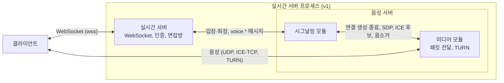
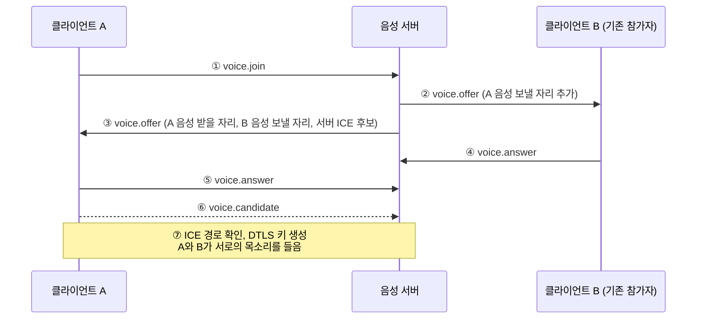
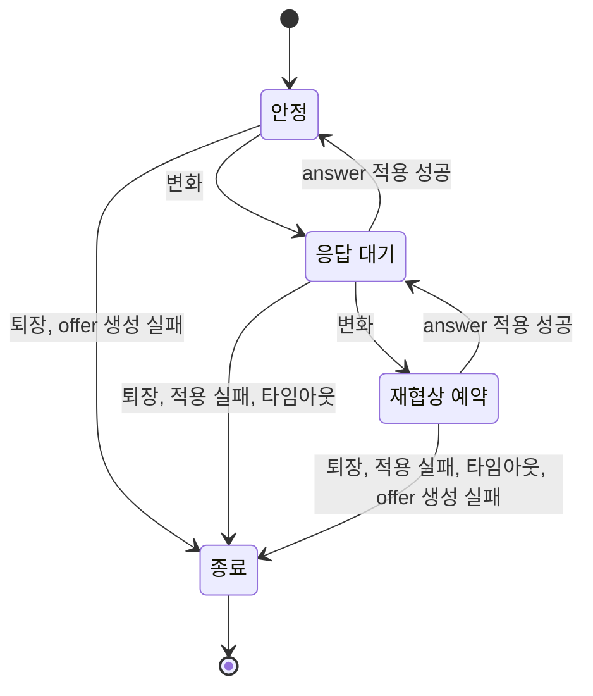

# 음성 통화 설계

담당: happyhun | 최종 갱신: 2026-11-27

## 개요

면접방 참가자 4명(면접자 2명, 면접관 2명)이 음성으로 대화한다. 실시간 서버 안의 음성 서버가 각 참가자의 음성을 받아 같은 방의 나머지 참가자에게 그대로 전달한다(SFU). core는 음성에 관여하지 않는다.

## 목표와 비목표

**목표**

- 한쪽이 말한 소리가 상대에게 들리기까지 150ms 이내다. ITU-T G.114는 단방향 지연이 150ms 이하이면 대부분의 대화에 지장이 없다고 본다.
- 참가자의 음성을 화자별로 따로 전달해, 클라이언트가 그 사람의 아바타에서 소리를 낼 수 있게 한다.
- 클라이언트가 방에서 누가 말하고 있는지 알 수 있게 한다.
- 네트워크가 잠깐 끊겨도 다시 입장하지 않고 대화가 이어진다.
- UDP를 막는 기업망이나 학교망에서도 연결된다.

**비목표**

- 영상과 화면 공유
- WebSocket 연결, 접속 인증, 면접방 관리. 실시간 서버가 맡는다
- 아바타 움직임, 채팅, 면접 진행 같은 다른 실시간 기능
- 클라이언트 구현
- 서버 녹음
- 서버 이중화와 무중단 배포

## 서버별 역할

- core (Java): 없음
- realtime (Go): 실시간 서버가 WebSocket 연결, 접속 인증, 면접방을 맡고, 그 안의 음성 서버가 시그널링과 음성 전달을 맡는다. v1은 한 프로세스로 돈다.



- **시그널링 모듈:** 방마다 음성 참가자와 음소거 상태를 관리하고, 누가 누구의 음성을 받을지 정하며, 참가자별 협상 상태 머신을 돌린다. v1 구독 정책은 '같은 방 전원'이다.
- **미디어 모듈:** Pion으로 참가자마다 WebRTC 연결을 하나씩 맺는다. 들어온 음성 패킷을 압축을 풀지 않고, 받는 사람의 키로 다시 암호화해 내보낸다. TURN도 맡는다. 패킷 전달은 시그널링 처리를 거치지 않는다.

경계를 오가는 내용은 아래 표가 전부다. 미디어 모듈은 Pion 타입을 밖으로 드러내지 않으므로, 미디어 모듈을 별도 서버로 떼어 낼 때는 아래 두 행만 원격 호출로 바꾼다.

| 보내는 쪽 → 받는 쪽 | 내용 |
| --- | --- |
| 실시간 서버 → 음성 서버 | 방 입장과 퇴장, 클라이언트가 보낸 `voice.*` 메시지 |
| 음성 서버 → 실시간 서버 | 참가자 한 명이나 방 전체에 보낼 `voice.*` 메시지 |
| 시그널링 모듈 → 미디어 모듈 | 참가자 연결 생성과 종료, 구독 추가, 클라이언트가 보낸 answer와 ICE 후보, 음소거 상태 |
| 미디어 모듈 → 시그널링 모듈 | 클라이언트에 보낼 offer(서버 ICE 후보 포함), 연결 상태 변화 |

패키지 구조는 [services/realtime/README.md](../../services/realtime/README.md)에 있다.

## 흐름

WebRTC에서는 음성을 보내기 전에 양쪽이 연결 조건에 합의한다. 한쪽이 코덱, 트랙 목록, 암호화에 쓸 인증서 지문을 SDP 텍스트로 담아 offer를 보내면, 상대가 answer로 응답한다. 이 과정을 시그널링이라 하고, 이 서버는 실시간 서버의 WebSocket으로 한다.

### 입장과 첫 연결



시그널링 메시지는 실제로는 실시간 서버의 WebSocket을 거치지만 그림에서는 생략했다.

클라이언트는 마이크 권한을 `voice.join` 전에 받아 둔다. 첫 offer의 answer가 10초 안에 오지 않으면 연결이 닫힌다.

1. A가 `voice.join`을 보낸다(①). 서버는 A용 연결을 만들고, 기존 참가자 B의 연결에 A의 음성을 내보낼 송신 트랙을 붙여 B에게 새 offer를 보낸다(②). A의 음성이 아직 도착하지 않았어도 트랙은 입장할 때 붙인다.
2. 이어서 A에게 첫 offer를 보낸다(③). 이 offer에는 'A의 음성을 받을 자리'와 'B의 음성을 보낼 자리', 서버의 ICE 후보(연결될 수 있는 주소 후보)가 모두 들어 있다. 두 자리는 SDP 미디어 항목 하나를 함께 쓸 수 있다.
3. B가 응답한다(④). A는 첫 offer를 적용한 뒤 마이크 트랙을 `addTrack`으로 붙이고 answer를 보낸다(⑤). 브라우저는 마이크를 보낼 수 있는 첫 미디어 항목에 싣는다.
4. A는 자신의 ICE 후보를 찾는 대로 서버에 보낸다(⑥). 서버의 후보는 offer에 이미 들어 있어 따로 보내지 않는다. 통하는 경로를 확인한 뒤 DTLS로 암호 키를 만들면(⑦) A와 B가 서로의 목소리를 듣는다.

기존 참가자가 여럿이면 ②와 ④를 각자와 주고받는다.

같은 계정이 `voice.join`을 또 보내면 기존 연결을 닫고 새 연결로 바꾼다. 입장하지 않은 참가자가 보낸 `voice.answer`, `voice.candidate`, `voice.setMuted`, `voice.leave`는 무시한다.

### 재협상

연결된 뒤 트랙이 늘거나 줄면 offer와 answer를 다시 주고받는다. 이를 재협상이라 하며, 이미 찾은 경로와 암호 키는 그대로 쓰므로 재협상하는 동안에도 기존 음성은 끊기지 않는다. 누가 들어오거나 나갈 때마다 서버는 방의 나머지 참가자 모두와 재협상한다.

- offer는 항상 서버만 만들고 클라이언트는 answer만 보낸다.
- 참가자마다 협상은 한 번에 하나만 진행한다. 진행 중에 또 변화가 생기면 표시만 해 두고, answer를 받은 뒤 그동안의 변화를 모아 offer 한 번으로 반영한다.
- 모든 offer에는 참가자마다 1부터 1씩 늘어나는 `offerId`를 붙인다. 마지막으로 보낸 offer와 `offerId`가 다른 answer는 버린다.
- answer보다 먼저 도착한 클라이언트의 ICE 후보는 모아 두었다가 answer를 적용한 직후에 넣는다.
- answer가 10초 안에 오지 않거나 적용에 실패하면 다시 시도하지 않는다. 연결을 닫고 `voice.error`(`CONNECTION_FAILED`)로 알리며, 클라이언트는 연결을 새로 만들고 `voice.join`을 보낸다. 10초는 초기값이고 테스트로 조정한다. 이유는 [ADR-0018](../adr/0018-voice-signaling.md)에 있다.

**협상 상태 머신**

참가자마다 하나씩 두고, 방 작업 큐에서 이벤트를 하나씩 받는다.

| 상태 | 코드 이름 | 뜻 |
| --- | --- | --- |
| 안정 | `Stable` | 진행 중인 협상이 없다 |
| 응답 대기 | `AwaitingAnswer` | offer를 보내고 answer를 기다린다 |
| 재협상 예약 | `RenegotiationPending` | answer를 기다리는 동안 또 변화가 생겼다. answer를 적용하면 곧바로 다음 offer를 보낸다 |
| 종료 | `Closed` | 참가자가 나갔거나 협상에 실패해 연결을 닫았다. 마지막 상태다 |

상태 말고도 마지막으로 보낸 offer의 `offerId`, answer보다 먼저 와서 보관 중인 ICE 후보를 함께 관리한다.

| 이벤트 | 발생 시점 |
| --- | --- |
| 변화 | 같은 방에 누가 들어오거나 나가 받는 트랙이 바뀌었을 때, ICE 재시작이 필요할 때(연결 실패 감지, `voice.restartIce` 수신). 참가자의 첫 연결도 변화로 처리한다 |
| answer 수신 | 클라이언트의 `voice.answer`가 도착했을 때 |
| ICE 후보 수신 | 클라이언트의 `voice.candidate`가 도착했을 때 |
| 타임아웃 | offer를 보내고 10초가 지났을 때. 어느 offer의 타이머인지 알 수 있게 그 offer의 `offerId`를 싣는다 |
| 퇴장 | 참가자가 음성에서 나갔을 때 |

| # | 현재 상태 | 이벤트 | 조건 | 동작 | 다음 상태 |
| --- | --- | --- | --- | --- | --- |
| 1 | 안정 | 변화 | | `offerId`를 1 올려 offer를 보내고 타이머를 건다 | 응답 대기 |
| 2 | 안정 | ICE 후보 수신 | | 바로 적용한다 | 안정 |
| 3 | 안정 | answer 수신 | | 기다리는 offer가 없으므로 버린다 | 안정 |
| 4 | 안정 | 타임아웃 | | 이미 끝난 offer의 타이머이므로 무시한다 | 안정 |
| 5 | 응답 대기 | 변화 | | 없음 | 재협상 예약 |
| 6 | 재협상 예약 | 변화 | | 없음. 이미 예약돼 있다 | 재협상 예약 |
| 7 | 응답 대기, 재협상 예약 | ICE 후보 수신 | | 보관한다 | 그대로 |
| 8 | 응답 대기, 재협상 예약 | answer 수신 | `offerId`가 다름 | 버린다 | 그대로 |
| 9 | 응답 대기 | answer 수신 | `offerId`가 같고 적용 성공 | 보관한 ICE 후보를 적용한다 | 안정 |
| 10 | 재협상 예약 | answer 수신 | `offerId`가 같고 적용 성공 | 9번과 같이 처리한 뒤, `offerId`를 1 올려 그동안의 변화를 담은 offer를 보내고 타이머를 건다 | 응답 대기 |
| 11 | 응답 대기, 재협상 예약 | answer 수신 | `offerId`가 같고 적용 실패 | 연결을 닫고 `CONNECTION_FAILED`를 보낸다 | 종료 |
| 12 | 응답 대기, 재협상 예약 | 타임아웃 | `offerId`가 같음 | 연결을 닫고 `CONNECTION_FAILED`를 보낸다 | 종료 |
| 13 | 응답 대기, 재협상 예약 | 타임아웃 | `offerId`가 다름 | 이전 offer의 타이머이므로 무시한다 | 그대로 |
| 14 | 안정, 응답 대기, 재협상 예약 | 퇴장 | | 연결을 닫는다 | 종료 |

1번과 10번에서 offer를 만들지 못하면 연결을 닫고 `CONNECTION_FAILED`를 보낸 뒤 종료로 간다.

answer를 적용하거나 퇴장해도 타이머는 풀지 않는다. 끝난 offer의 타이머가 울리면 4번이나 13번으로 무시한다.

종료 상태에서는 모든 이벤트를 무시한다. 위 목록은 종료를 뺀 모든 상태와 이벤트 조합을 다룬다.



그림에는 상태가 바뀌는 전이만 그렸다. 상태가 그대로인 전이는 위 목록을 본다.

### 음소거

음소거는 재협상하지 않는다. 클라이언트가 `voice.setMuted`를 보내면 서버는 트랙을 그대로 둔 채 그 참가자의 패킷 전달을 멈춘다.

- 음소거 상태가 바뀌면 방의 나머지 참가자에게 `voice.muted`로 알린다. 보낸 사람에게는 보내지 않는다. 이미 그 상태이면 아무것도 하지 않는다.
- 참가자는 음소거하지 않은 상태로 입장한다. 처음부터 음소거하려면 `voice.join` 뒤에 `voice.setMuted`를 보낸다.
- 새로 들어온 참가자에게는 입장 직후 음소거 중인 기존 참가자의 상태만 `voice.muted`로 보낸다. 받지 않은 참가자는 음소거하지 않은 것으로 본다.
- 음소거 중인 참가자가 나가면 나머지 참가자에게 그 참가자의 `voice.muted`를 `muted: false`로 보낸다. 같은 계정이 다시 입장하면 음소거하지 않은 상태로 시작한다.

### 화자 식별과 발화 감지

- **화자 식별:** 서버가 화자마다 만드는 송신 트랙의 스트림 ID(SDP에 실리는 이름표)에 화자의 방 참가자 ID를 넣는다. 클라이언트는 트랙을 받을 때 이 값으로 누구의 목소리인지 안다.
- **발화 감지:** 서버가 offer에 RFC 6464 오디오 레벨 확장을 넣으면, 클라이언트는 패킷 헤더마다 그 순간의 음량(0~127, 0이 가장 큼)을 채워 보낸다. 서버는 이 값을 고치지 않고 패킷과 함께 넘기고, 발화는 받는 클라이언트가 판정한다. 서버는 모든 연결의 offer에서 이 확장에 같은 ID를 주므로, 넘긴 패킷의 값을 받는 쪽이 그대로 읽는다. 이유는 [ADR-0019](../adr/0019-voice-detect-speaking-on-client.md)에 있다.
  - 클라이언트는 화자의 트랙을 받는 `RTCRtpReceiver`의 `getSynchronizationSources()`에서 `audioLevel`을 읽는다.
  - 기준보다 큰 소리가 100ms 이어지면 발화 시작, 500ms 동안 기준보다 작으면 발화 종료로 본다.
  - DTX 때문에 무음 구간에는 패킷이 거의 오지 않으므로, 판정은 패킷 수가 아니라 시간으로 하고 패킷이 오지 않는 시간도 기준보다 작은 것으로 본다. 항목의 `timestamp`가 갱신되지 않거나 항목이 없으면 패킷이 오지 않는 것이다. 음소거한 참가자도 서버가 패킷을 넘기지 않으므로 같다.
  - 기준 음량은 실제 마이크로 측정해 정하고, 두 시간 값은 초기값이며 테스트로 조정한다.

### 면접 전 점검

클라이언트가 `voice.probe`를 보내면 서버는 점검용 연결의 offer를 보낸다. 성공 여부와 TCP 경로인지는 클라이언트가 연결 상태와 `getStats()`로 판단하고, 점검이 끝나면 `voice.leave`로 점검용 연결을 닫는다.

## API

시그널링 메시지는 실시간 서버의 WebSocket으로 오가는 JSON으로, `type`과 `payload` 필드로 이루어진다.

- 타입 이름은 `voice.` 접두사 뒤에 camelCase로 쓴다.
- 필드 이름은 대소문자를 구분한다.
- `payload`를 생략하거나 `null`로 보내면 빈 객체로 본다. 그래서 payload가 없는 메시지는 세 형태 중 어느 것으로 보내도 되고, payload가 있는 메시지를 이렇게 보내면 필수 필드 누락이 된다.

```json
{
  "type": "voice.answer",
  "payload": { "sdp": "v=0\r\n...", "offerId": 3 }
}
```

| 타입 | 방향 | payload | 용도 |
| --- | --- | --- | --- |
| `voice.join` | 클라이언트 → 서버 | 없음 | 현재 면접방 음성에 참여 |
| `voice.offer` | 서버 → 클라이언트 | `sdp`, `offerId`, `iceServers` | 서버가 만든 offer. `iceServers`는 첫 offer와 ICE 재시작 offer에만 싣고, TURN을 끈 환경에서는 싣지 않는다 |
| `voice.answer` | 클라이언트 → 서버 | `sdp`, `offerId` | 받은 offer와 같은 `offerId`로 응답 |
| `voice.candidate` | 클라이언트 → 서버 | `candidate`, `sdpMid`, `sdpMLineIndex`, `usernameFragment` | ICE 후보. 수집이 끝나면 `candidate`를 빈 문자열로 보낸다. 서버의 후보는 offer의 SDP에 모두 들어 있다 |
| `voice.restartIce` | 클라이언트 → 서버 | 없음 | 네트워크가 바뀐 것을 클라이언트가 먼저 알았을 때 ICE 재시작 offer를 요청 |
| `voice.setMuted` | 클라이언트 → 서버 | `muted` | 내 음소거 상태 설정. 켜기와 끄기 모두 이 메시지로 보낸다 |
| `voice.muted` | 서버 → 클라이언트 | `participantId`, `muted` | 방 참가자의 음소거 상태 |
| `voice.leave` | 클라이언트 → 서버 | 없음 | 음성에서 나가거나 점검을 끝냄 |
| `voice.probe` | 클라이언트 → 서버 | 없음 | 면접 전에 음성 연결이 되는지 점검 |
| `voice.error` | 서버 → 클라이언트 | `reason`, `message`, `metadata` | 요청이나 음성 연결의 실패. `reason`은 `FORBIDDEN`(방 참가자가 아니거나 게스트), `INVALID_MESSAGE`(형식 오류), `CONNECTION_FAILED`(서버가 연결을 열거나 협상하지 못해 연결을 닫음. 클라이언트는 `RTCPeerConnection`을 새로 만들고 `voice.join`을 보낸다), `NETWORK_BLOCKED`(면접 중 사용자 네트워크가 음성 포트를 막은 것으로 추정) |

| 필드 | 타입 | 설명 |
| --- | --- | --- |
| `sdp` | string | SDP 텍스트 |
| `offerId` | integer | offer 식별자. 참가자마다 첫 offer가 1이고, 서버가 offer를 보낼 때마다 1씩 늘린다. answer는 응답하는 offer의 `offerId`를 그대로 싣는다 |
| `iceServers` | array | W3C `RTCIceServer` 배열. 각 항목은 `urls`, `username`, `credential`. 필드가 없으면 클라이언트는 이전 설정을 그대로 쓰고, 첫 offer에 없으면 TURN 없이 연결한다 |
| `candidate` | string | ICE 후보 문자열. 필수다. 수집이 끝나면 빈 문자열이고, 이때도 필드를 빼지 않는다 |
| `sdpMid` | string \| null | W3C `RTCIceCandidate.sdpMid` |
| `sdpMLineIndex` | integer \| null | W3C `RTCIceCandidate.sdpMLineIndex` |
| `usernameFragment` | string \| null | W3C `RTCIceCandidate.usernameFragment` |
| `muted` | boolean | `true`면 음소거. 필수다 |
| `participantId` | string | 방 참가자 ID |
| `reason` | string | 에러 원인. UPPER_SNAKE_CASE 상수이고 클라이언트는 이 값으로 분기한다 |
| `message` | string | 개발자용 영어 메시지. 원인마다 고정된 문구에 해결 방법을 붙인다. 바뀔 수 있으므로 클라이언트는 파싱하지 않는다 |
| `metadata` | object | 같은 `reason` 안에서 달라지는 값. 키와 값은 문자열이고, 같은 `reason`이면 늘 같은 키가 있다. 모든 `reason`에 원인 `cause`가 있고, `INVALID_MESSAGE`에는 잘못된 필드의 JSON Pointer `field`(가리킬 필드가 없으면 빈 문자열)도 있다 |

아래 경우는 모두 `INVALID_MESSAGE`로 응답한다.

| 경우 | `cause` | `field` |
| --- | --- | --- |
| JSON 형식 오류, 잘못된 UTF-8 | `invalid-json` | 빈 문자열 |
| 같은 필드 이름이 두 번 나오는 객체 | `duplicate-field` | 빈 문자열 |
| 객체가 아닌 `payload` | `payload-not-object` | `/payload` |
| 모르는 `type`. 클라이언트가 서버 → 클라이언트 전용 타입(`voice.offer`, `voice.muted`, `voice.error`)을 보낸 경우도 포함한다 | `unknown-type` | `/type` |
| 필드 타입 오류 | `wrong-field-type` | 그 필드 |
| 필수 필드 누락. 필드 이름의 대소문자가 다르면 그 필드는 없는 것으로 본다 | `missing-field` | 그 필드 |
| `offerId`가 1보다 작은 answer | `invalid-field-value` | `/payload/offerId` |
| `candidate`가 빈 문자열이 아닌데 `sdpMid`와 `sdpMLineIndex`가 둘 다 null인 후보 | `missing-field` | `/payload/sdpMid` |

`message`는 `cause`마다 고정된 문구에 "fix the message and send it again"을 붙인다.

모르는 필드는 무시한다.

`CONNECTION_FAILED`의 `cause`는 실패한 단계인 `open-connection`, `create-offer`, `apply-answer`, `answer-timeout` 중 하나다. `message`는 `cause`마다 다른 고정 문구에 "create a new RTCPeerConnection and send voice.join"을 붙인다.

첫 offer:

```json
{
  "type": "voice.offer",
  "payload": {
    "sdp": "v=0\r\n...",
    "offerId": 1,
    "iceServers": [
      {
        "urls": ["turns:turn.example.com:443?transport=tcp"],
        "username": "<만료 시각>:<participantId>",
        "credential": "<HMAC>"
      }
    ]
  }
}
```

ICE 후보 수집 끝:

```json
{
  "type": "voice.candidate",
  "payload": { "candidate": "", "sdpMid": "0", "sdpMLineIndex": 0, "usernameFragment": null }
}
```

형식 오류:

```json
{
  "type": "voice.error",
  "payload": { "reason": "INVALID_MESSAGE", "message": "a field has the wrong type; fix the message and send it again", "metadata": { "cause": "wrong-field-type", "field": "/payload/offerId" } }
}
```

## 관련 결정

- [다자간 음성에 SFU 구조를 쓴다](../adr/0014-voice-use-sfu.md)
- [SFU를 Pion으로 직접 구현한다](../adr/0015-voice-build-sfu-with-pion.md)
- [v1은 음성 서버를 실시간 서버 프로세스 안에서 돌린다](../adr/0016-voice-run-in-realtime-process.md)
- [참가자마다 연결 하나를 두고 트랙이 바뀌면 재협상한다](../adr/0017-voice-renegotiate-single-connection.md)
- [음성 시그널링은 서버만 offer를 만들고 W3C 이름과 AIP-193 에러 형식을 쓴다](../adr/0018-voice-signaling.md)
- [발화는 서버가 아니라 받는 클라이언트가 판정한다](../adr/0019-voice-detect-speaking-on-client.md)

## 네트워크 배치

서버에 공인 IP를 붙이고, 설정으로 받은 공인 IP를 ICE 후보로 내보낸다. 이 설정을 비워 두면 사설 IP만 내보내므로, 개발할 때는 같은 노트북이나 같은 네트워크 안에서 그대로 실행해 볼 수 있다.

음성 경로는 세 가지다. 통하는 경로가 여럿이면 ICE 우선순위에 따라 UDP, ICE-TCP, TURN 순으로 고른다.

| 경로 | 통하는 네트워크 |
| --- | --- |
| UDP | 대부분의 네트워크. 공유기 뒤의 클라이언트가 먼저 보내고 서버 응답이 그 경로로 돌아온다 |
| ICE-TCP | UDP만 막고 다른 TCP 포트는 열어 둔 네트워크. 같은 연결을 UDP 대신 TCP로 맺는다 |
| TURN over TLS | 443 포트로 나가는 웹 접속만 허용하는 네트워크. 클라이언트와 TLS로 연결해 받은 음성을 미디어 모듈에 대신 전달한다 |

- **TURN:** 미디어 모듈 안에 Pion TURN으로 둔다. 두 번째 공인 IP의 443 포트로 받고, TURN 도메인과 그 인증서를 둔다. 중계 주소로 서버의 사설 IP를 써서 중계된 음성이 서버 밖으로 다시 나가지 않는다. 개발할 때는 TURN을 끄고 UDP 경로만으로 실행한다.
- **TURN 자격 증명:** 참가자마다 만료 시각이 들어간 임시 자격 증명을 만들어 첫 offer와 ICE 재시작 offer에 싣는다. 유효 기간은 면접 한 번보다 넉넉하게 잡는다. TURN은 계정을 저장하지 않고 같은 계산으로 검증한다.
  - 사용자 이름: `<만료 시각>:<participantId>`. 만료 시각은 Unix 초다
  - 비밀번호: 서버만 아는 비밀 키로 사용자 이름의 HMAC-SHA1을 계산해 base64로 인코딩한 값
- **TCP 경로의 지연:** ICE-TCP와 TURN은 패킷 하나가 손실되면 재전송될 때까지 뒤따르는 패킷도 기다린다. 손실이 잦은 네트워크에서는 150ms 목표를 넘을 수 있다.

외부에 여는 포트는 네 개다. 음성 포트는 UDP와 TCP 각각 하나씩만 두고 모든 연결이 함께 쓴다.

| 용도 | 프로토콜 | 포트 | 비고 |
| --- | --- | --- | --- |
| 시그널링 | TCP, WebSocket over TLS(wss) | 443 | TLS 인증서는 서버가 직접 둔다 |
| 음성 | UDP | 1개 | ICE UDP mux |
| 음성 (UDP가 막힐 때) | TCP, ICE-TCP | 1개 | ICE TCP mux |
| TURN 중계 | TCP, TURN over TLS | 443 | 두 번째 공인 IP에서 받는다 |

## 장애와 복구

음성 연결 상태는 프로세스 메모리에만 둔다.

| 상황 | 동작 |
| --- | --- |
| 네트워크가 잠깐 끊김 | 연결이 '끊김' 상태가 돼도 바로 정리하지 않는다. 대부분 몇 초 안에 저절로 복구된다 |
| Wi-Fi에서 LTE로 바뀌는 등 경로를 완전히 잃음 | 연결이 '실패' 상태가 되면 서버가 ICE 재시작 offer를 보낸다. 클라이언트가 먼저 알아차리면 `voice.restartIce`로 요청한다. WebSocket도 함께 끊겼다면 다시 붙은 뒤에 보낸다. 트랙과 협상 내용은 그대로 두고 경로만 새로 찾는다 |
| 사용자 네트워크가 음성 포트를 막음 | answer를 받고 10초(초기값) 안에 연결 확인 패킷이 UDP로도 TCP로도 오지 않고, 같은 때 다른 참가자는 정상이면 `voice.error`로 `NETWORK_BLOCKED`를 보낸다. 아무도 연결되지 않으면 서버 쪽 포트 문제로 보고 경고 로그를 남긴다 |
| answer가 늦거나 적용에 실패함 | 연결을 닫고 `voice.error`(`CONNECTION_FAILED`)를 보낸다. 클라이언트는 연결을 새로 만들고 `voice.join`을 보낸다 |
| WebSocket만 끊김 | 30초(초기값) 동안 음성 연결을 유지한다. 그 안에 다시 붙으면 이어서 쓰고, 지나면 퇴장으로 처리한다 |
| 퇴장 | 연결을 닫고, 나머지 참가자 연결에서 그 사람의 트랙을 빼며 재협상한다 |
| 서버 재시작 또는 배포 | 모든 연결이 사라진다. 클라이언트는 WebSocket에 다시 접속해 `voice.join`을 보낸다. 배포는 면접이 없는 시간에 한다 |

패킷 손실은 재전송으로 메우지 않는다. 서버의 offer에 `useinbandfec=1`을 넣어 Opus FEC를 켜면, 다음 패킷에 앞 패킷 정보가 일부 실려 받는 쪽이 빈 구간을 메운다.

## 보안

- 실시간 서버가 인증하고 방 구성원으로 확인한 사용자에게만 연결을 만들고, 같은 방 참가자의 음성만 보낸다.
- 클라이언트 메시지를 보낸 사람은 payload가 아니라 메시지가 들어온 연결로 판단하고, 메시지마다 그 사람이 지금 방 참가자인지 확인한다.
- 연결마다 DTLS 핸드셰이크로 암호 키를 만들고, 음성은 그 키로 암호화한 SRTP로 보낸다. 인증서 지문은 SDP에 담겨 인증된 WebSocket으로만 오간다.
- 시그널링으로 주고받은 ICE 자격 증명이 맞지 않는 패킷은 연결 확인 단계에서, 키가 맞지 않는 SRTP 패킷은 복호화 단계에서 버려진다.
- TURN은 시그널링으로 받은 임시 자격 증명이 있어야 접속할 수 있고, 중계 대상은 이 서버의 음성 포트로만 제한한다.
- 서버는 연결마다 암호를 풀고 다시 걸므로 기술적으로 음성 내용에 접근할 수 있다. 서버는 음성을 저장하지 않는다. 종단 간 암호화가 필요해지면 클라이언트가 SFrame(RFC 9605)으로 한 번 더 암호화한다. 이때도 음량 값은 SFrame이 암호화하지 않는 패킷 헤더에 실리므로 발화 감지는 그대로 동작하지만, 참가자가 바뀔 때마다 키를 나눠 주고 교체하는 일을 클라이언트에 새로 만들어야 한다.

## 용량

음성 스트림 하나는 Opus 32kbps 기준 20ms마다 패킷 하나(초당 50개), 헤더를 포함해 약 50kbps다. 4명 방에서 서버는 스트림 4개를 받고 12개를 내보내, 방 하나가 약 800kbps를 쓰고 초당 800패킷을 처리한다. 네 명이 모두 쉬지 않고 말할 때의 최대값이다. 서버는 offer에 `usedtx=1`을 넣어 말하지 않는 동안 패킷을 거의 보내지 않게 하지만, 수용량은 이 최대값으로 잡는다.

| 동시 면접방 | 동시 접속자 | 대역폭 (송수신 합) | 초당 패킷 |
| --- | --- | --- | --- |
| 50 | 200명 | 약 40Mbps | 약 4만 |
| 100 | 400명 | 약 80Mbps | 약 8만 |
| 200 | 800명 | 약 160Mbps | 약 16만 |

CPU는 주로 패킷마다 암호를 풀고 다시 거는 데 쓰인다. TURN으로 붙는 연결은 TLS와 중계가 더해져 더 무겁다. 서버 한 대가 감당하는 방 수는 부하 테스트로 정하고, 실제 동시 사용량이 그 값에 가까워지면 미디어 모듈을 분리한다.

## 관측성

OpenTelemetry로 로그, 메트릭, 트레이스를 남긴다.

- **트레이스:** 입장부터 첫 음성 패킷 도착까지(`voice.join`, offer, answer, ICE 연결, DTLS 완료)를 하나의 트레이스로 남기고, 재협상도 매번 남긴다. 패킷 전달은 트레이스하지 않는다.
- **메트릭:** 경로(UDP, ICE-TCP, TURN)별 활성 연결 수, 연결 성립에 걸린 시간, 협상 실패와 타임아웃 수, 트랙별 패킷 손실률과 지터, 초당 패킷 수
- **로그:** 항상 `roomId`, `participantId`, `offerId`와 트레이스 ID를 남긴다.

## 테스트

| 종류 | 확인할 것 | 방법 | 통과 기준 |
| --- | --- | --- | --- |
| 단위 테스트 | 협상 상태(answer 대기 중 변화 합치기, `offerId`가 다른 answer, answer 타임아웃, answer보다 먼저 온 ICE 후보), 구독 정책, TURN 자격 증명 검증 | Go 테스트 | 협상 상태 머신은 코드 경로마다 한 건씩 검사하고, 같은 코드를 지나는 전이는 직접 확인한다. 만료되거나 위조된 TURN 자격 증명은 거부한다 |
| 통합 테스트 | 동시 입장, 입장과 퇴장 반복, 같은 계정 재입장, WebSocket 재접속 유예, ICE 재시작, 서버 재시작 후 재입장, 음소거 중 전달 중단, 입장 시 음소거 상태 전달, 음량 값 전달 | Pion으로 만든 가짜 클라이언트 4개를 실제 서버에 붙인다 | 협상 오류 없이 모든 참가자가 나머지 참가자의 음성을 받는다. 한 참가자가 보낸 음량 값을 다른 참가자가 같은 값으로 받는다. 입장과 퇴장을 100번 반복해도 SDP의 미디어 항목 수가 처음보다 하나 넘게 늘지 않는다([ADR-0017](../adr/0017-voice-renegotiate-single-connection.md)) |
| 호환성 테스트 | Chrome, Edge, Safari, Firefox 최신 버전 | 서로 다른 브라우저로 한 방을 채워 통화한다 | 모든 조합에서 입장, 대화, 음소거, 발화 감지, 퇴장이 동작한다 |
| 장애 주입 테스트 | 패킷 손실, 지연, 지터, 회선 전환, UDP 차단 | tc netem으로 손실 1%, 5%, 10%와 지연 100ms, 지터 30ms를 넣는다. Wi-Fi와 LTE를 오간다. 방화벽으로 UDP를 막은 경우와 443 외의 포트를 모두 막은 경우도 시험한다 | 재입장 없이 대화가 이어진다. 회선 전환은 ICE 재시작으로 복구된다. UDP를 막으면 ICE-TCP로, 443만 열어 두면 TURN으로 연결된다. TURN을 끈 환경에서는 `NETWORK_BLOCKED`를 받는다 |
| 지연 시간 테스트 | 말소리가 상대에게 들리기까지 걸리는 시간 | 가정용 인터넷과 LTE 같은 실제 사용자 네트워크에서 가짜 클라이언트 두 개를 배포할 지역의 서버에 붙이고, 한쪽이 받은 패킷을 곧바로 되돌려 보내 왕복 시간을 잰다 | 왕복 시간의 절반이 90ms 이내다. 클라이언트 쪽 지연(음성을 20ms 단위로 묶는 시간과 지터 버퍼)은 초기값 60ms로 잡고, 브라우저 통계로 확인해 조정한다 |
| 부하 테스트 | 서버 한 대의 수용량 | 가짜 클라이언트로 4명 방을 늘려 가며 참가자마다 초당 50개의 Opus 패킷을 보낸다 | CPU 사용률이 70%에 이를 때의 방 수를 수용량으로 기록한다 |
| 내구성 테스트 | 자원 누수 | 입장과 퇴장을 반복하며 24시간 돌린다 | 끝난 뒤 고루틴 수와 메모리가 시작 수준으로 돌아온다 |
