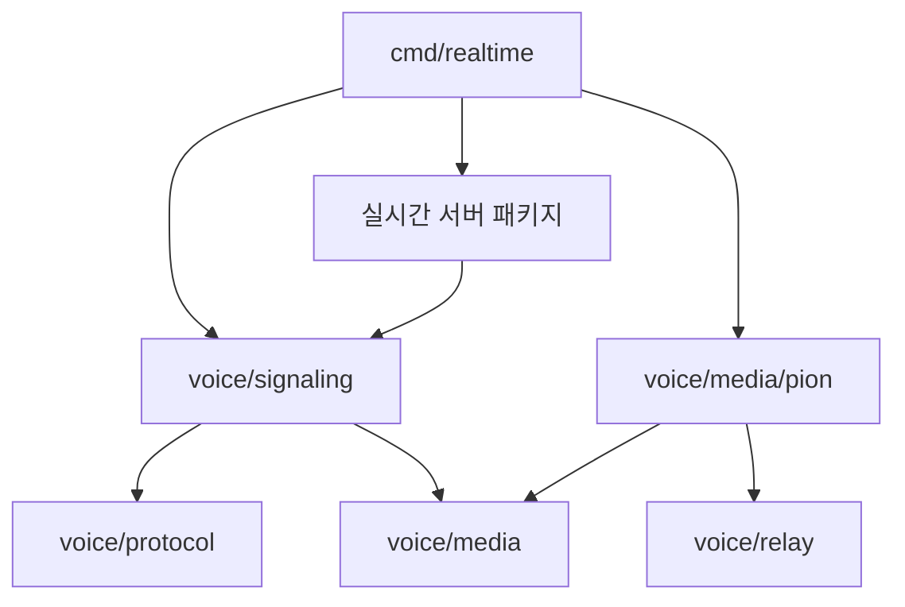

# realtime

실시간 서버입니다.

## core에서 받아오는 것

- `GetParticipants` (gRPC): 참여자 목록

## 패키지

```
services/realtime/
├── cmd/realtime/          # main. 설정을 읽고 패키지를 조립한다
└── internal/
    ├── ...                # 실시간 서버 패키지. 실시간 서버 설계에서 정한다
    └── voice/             # 음성 서버. 설계는 docs/design/voice.md
        ├── protocol/      # voice.* 메시지 타입과 JSON 변환
        ├── signaling/     # 방 작업 큐, 방 상태, 구독 정책, 협상 상태 머신
        ├── media/         # 시그널링과 미디어 사이의 계약. 인터페이스와 값 타입만 둔다
        │   └── pion/      # Pion으로 만든 media 구현. 연결 관리, 패킷 전달, TURN
        └── relay/         # TURN 서버, 임시 자격 증명 생성과 검증
```

`relay`는 `turn`이라고 하면 import하는 `pion/turn`과 이름이 겹쳐서 붙인 이름이다.



화살표는 import 방향이다.

### 음성 패키지 규칙

1. 위 그림의 화살표를 거스르는 import는 하지 않는다. 지금은 리뷰로 확인하고, 자동 검사 방법은 아직 정하지 않았다.
2. `protocol`, `media`, `relay`는 다른 음성 패키지를 import하지 않는다.
3. Pion은 `media/pion`과 `relay`에서만 import한다. `media` 계약에는 Pion 타입이 나오지 않는다.
4. 실시간 서버 패키지는 `signaling`만 import한다. 음성 서버는 실시간 서버 패키지를 import하지 않는다. 음성 서버가 클라이언트에 메시지를 보내는 방법은 실시간 서버와 연결할 때 정한다.
5. 구현체를 만들어 연결하는 코드는 `cmd/realtime`에만 둔다. 다른 패키지는 생성자로 받은 인터페이스만 쓴다. 예외로 `signaling`의 통합 테스트는 `media/pion`으로 실제 연결을 만든다.
6. 디렉터리 중첩은 '부모는 계약, 자식은 구현'일 때만 쓴다. `media`와 `media/pion`만 해당한다. `voice/`에는 Go 코드를 두지 않는다.
7. 인터페이스는 쓰는 쪽 패키지에 둔다. 예외는 `media` 계약 하나다. 구현이 이름을 써야 하는 타입(`Open`이 돌려주는 `Conn`, `AddCandidate`가 받는 `Candidate`)이 있어, 쓰는 쪽인 `signaling`에 두면 `media/pion`이 `signaling`을 import하게 된다.

### 상태와 동시성

- 방 상태(음성 참가자 목록, 음소거 상태)와 구독 정책은 `signaling`만 갖는다. 미디어 모듈은 방을 모르고, `Subscribe`, `SetMuted`로 받은 대로 패킷만 전달한다.
- v1 구독 정책은 '같은 방 전원'을 돌려주는 함수 하나라 패키지로 나누지 않는다.
- 방마다 작업 큐 하나를 두고, 큐에 일이 있을 때만 고루틴 하나가 한 번에 하나씩 처리한다. 큐가 비면 고루틴이 끝난다. 입장, 퇴장, 클라이언트 메시지, 미디어 알림, 협상 타이머가 모두 이 큐로 들어오고, 방 상태와 협상 상태는 이 고루틴만 읽고 쓴다.
- 큐는 크기 제한 없이 쌓이는 구조로 만들고, 넣는 쪽은 막히지 않는다. `media.Handler` 구현은 Pion 고루틴에서 호출되므로 이벤트를 큐에 넣고 바로 반환한다.
- 음성 패킷은 큐를 거치지 않는다.

### media 계약

| 방향 | 형태 | 내용 |
| --- | --- | --- |
| 시그널링 → 미디어 | `media.Driver.Open`과 `media.Conn`의 메서드 | 연결 생성(`Open`)과 종료(`Close`. 그 연결이 낀 구독도 끝난다), 구독 추가(`Subscribe`), offer 생성(`CreateOffer`), answer 적용(`ApplyAnswer`), ICE 후보 추가(`AddCandidate`), 음소거(`SetMuted`) |
| 미디어 → 시그널링 | `media.Handler`의 메서드. `signaling`이 구현한다 | 연결 상태 변화(`ConnectionStateChanged`) |

- `Subscribe`는 화자의 음성이 아직 도착하지 않았어도 송신 트랙을 바로 붙인다. 트랙은 입장과 퇴장 때만 바뀌므로, `signaling`이 그때 협상 상태 머신에 변화를 알려 `CreateOffer`를 호출한다.
- `CreateOffer`가 돌려주는 SDP에는 서버의 ICE 후보가 모두 들어 있다.

## 실행 방법

- 추후 작성
